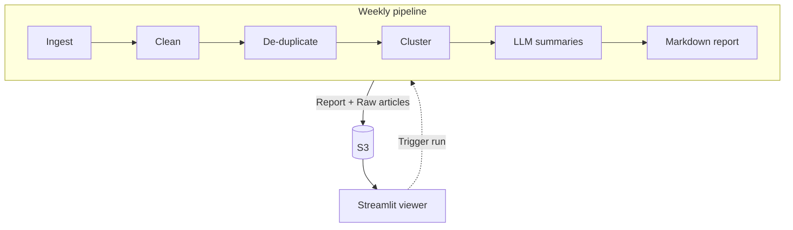

# Jeelna News Bot

An automated weekly pipeline that collects news articles on Sudan, cleans and groups related stories by theme, then publishes a short, source-linked summary report for the [Jeelna](https://jeelnasudani.org) non-profit humanitarian aid organization.

**Live Viewer:** [jeelnasudani.org/news](https://jeelnasudani.org/news)

## What it does

Every Sunday, a GitHub Actions workflow runs a pipeline that ingests the last seven days of articles about Sudan from NewsAPI, excludes off-topic or low-relevance mentions, removes junk, null, exact and near-duplicate articles, and clusters the remaining stories by topic using semantic embeddings. The pipeline then uses an LLM to write one short summary per theme. Every claim in a summary links back to a source article.

The finished report is stored in a private S3 bucket and displayed in a Streamlit viewer embedded on the [Jeelna website](https://jeelnasudani.org/news).

The viewer also has a button to trigger a fresh run on demand.

## How it works



| Stage | File | What it does |
|---|---|---|
| Ingest | `ingest.py` | Calls NewsAPI `/v2/everything` on articles within the previous 7 days and saves the raw JSON. |
| Clean | `clean.py` | Drops articles with repeated or missing URLs, null titles or descriptions, and cookie-consent pages. |
| De-duplicate | `dedup.py` | Drops near-duplicate headlines using a Jaccard overlap of words, keeping the most recent of each. |
| Cluster | `cluster.py` | Embeds titles and descriptions with `all-MiniLM-L6-v2`, then groups articles using agglomerative clustering (cosine distance, average linkage, distance threshold). |
| Summarize | `summarize.py` | Sends each article group to an LLM and expects a JSON object with three fields: `theme`, `summary`, `about_sudan`. |
| Report | `report.py` | Builds one markdown section per theme. |
| Store | `store.py` | Uploads the raw articles and the markdown report to S3. |
| Orchestrate | `main.py` | Runs the stages in order. |
| View | `app.py` | Streamlit app that shows the newest report from S3, and can trigger a new run. |

## Design choices and decisions

1. To ensure that an LLM does not invent an article during thematic summaries, numbered citations are resolved to direct source links from NewsAPI in `summarize.py`, and are never written by the LLM itself. The prompt numbers the input articles `[0]`, `[1]`, and so on, and the model cites the text by number.
2. Off-topic stories are filtered in two ways. Since querying "Sudan" can also pull unrelated stories (a Nepali politician, South Sudan, etc), common unrelated phrases are explicitly excluded in the NewsAPI query. Secondly, to ensure the relevance of articles, the LLM is prompted to return a flag in the JSON response, `about_sudan`, which is `true` for stories explicitly about Sudan, and `false` for stories only lightly mentioning Sudan in passing.
3. The agglomerative clustering model uses a distance threshold. Since the number of stories changes every week, the cluster count comes from the data instead of remaining a fixed value.
4. The LLM provider is swappable. Adapter functions were written for OpenAI, Anthropic, and Gemini behind the same interface, so that the same week can be run through each model and compared whenever necessary.
5. AWS access is least-privilege. The pipeline uses an IAM user that can write to the bucket, while the viewer uses a separate read-only user. The bucket blocks all public access and uses server-side encryption.
6. In order to keep full pipeline runs fast, CI runs were set to use CPU-only PyTorch, as well as cached pip and Hugging Face downloads. As a result, a Streamlit-triggered fresh run is ~2 minutes. 

## Sample output

> ## Deadly Strike on Darfur Market
> Military drone strikes hit a busy market in Darfur, Sudan, killing more than 100 people according to a rights group ([Al Jazeera English](https://www.aljazeera.com/news/2026/10/29/strikes-on-darfur-market-in-sudan-kill-more-than-100-rights-group-says)). Most of those killed were women and children, and witnesses said civilian vendors were among the victims ([Al Jazeera English](https://www.aljazeera.com/news/2026/10/29/strikes-on-darfur-market-in-sudan-kill-more-than-100-rights-group-says))([Abcnews.com](https://abcnews.com/International/wireStory/strike-darfur-market-killed-civilians-selling-food-fighters-137643013)). The market was frequented by paramilitary fighters, and some vendors were selling food to them ([Al Jazeera English](https://www.aljazeera.com/news/2026/10/29/strikes-on-darfur-market-in-sudan-kill-more-than-100-rights-group-says))([Abcnews.com](https://abcnews.com/International/wireStory/strike-darfur-market-killed-civilians-selling-food-fighters-137643013)).
> 
> ## Sudan's War Reshapes Family Life
> Sudan's war and economic hardship are leaving families in Khartoum struggling to afford food, with some borrowing money and skipping meals ([Al Jazeera English](https://www.aljazeera.com/features/2026/10/28/sudan-war-and-inflation-leave-families-struggling-to-survive-in-khartoum)). Children have lost access to schooling amid closures and displacement, and some work to help support their families ([Al Jazeera English](https://www.aljazeera.com/features/2026/10/27/sudans-war-steals-childrens-futures-with-school-closures-and-displacement)). One account describes care across generations of displacement and war as an enduring inheritance among Sudanese people ([Africasacountry.com](https://africasacountry.com/2026/10/how-a-child-inherits-care)). Together, the reports show how conflict is affecting daily survival, childhood, and family care in Sudan ([Al Jazeera English](https://www.aljazeera.com/features/2026/10/28/sudan-war-and-inflation-leave-families-struggling-to-survive-in-khartoum))([Al Jazeera English](https://www.aljazeera.com/features/2026/10/27/sudans-war-steals-childrens-futures-with-school-closures-and-displacement))([Africasacountry.com](https://africasacountry.com/2026/10/how-a-child-inherits-care)).
> 
> ## Sudan Faces Famine and Rising Living Costs
> The United States, the European Union and other countries warned that food security in Sudan is rapidly worsening and famine risk is growing ([Newser](https://www.newser.com/story/398863/a-war-torn-nation-is-on-the-brink-of-famine.html))([BBC News](https://www.bbc.co.uk/news/articles/cj5ynkk6v3pzo))([Al Jazeera English](https://www.aljazeera.com/news/2026/10/27/us-eu-and-30-countries-warn-of-famine-risk-in-sudan-call-for-aid)). They urged the warring parties to remove obstacles to humanitarian aid, while conflict, drought and funding cuts are aggravating the hunger crisis ([BBC News](https://www.bbc.co.uk/news/articles/cj5ynkk6v3pzo))([Al Jazeera English](https://www.aljazeera.com/news/2026/10/27/us-eu-and-30-countries-warn-of-famine-risk-in-sudan-call-for-aid)). Separately, soaring fuel prices are adding to Sudan’s cost-of-living crisis and making it harder for workers, including minibus drivers, to get by ([Al Jazeera English](https://www.aljazeera.com/economy/2026/10/24/sudans-soaring-fuel-prices-makes-getting-by-harder-for-workers)).
> 
> ## El Fasher Atrocities and Accountability
> A year after RSF violence around El Fasher reached a devastating peak on 26 October 2025, following months of siege and escalating attacks, international partners issued a statement on the atrocity ([Www.gov.uk](https://www.gov.uk/government/news/statement-from-the-coalition-on-atrocity-prevention-and-justice-for-sudan-one-year-on-from-the-26-october-2025-atrocity-in-el-fasher)). The UK announced sanctions against commanders suspected of atrocities, including conflict-related sexual violence, and further support for survivors ([Www.gov.uk](https://www.gov.uk/government/news/uk-sanctions-senior-commanders-implicated-in-campaign-of-rape-in-sudan-and-unveils-new-support-for-survivors)). A BBC investigation reported evidence that RSF fighters deliberately targeted at least 43 hospitals during the siege, potentially violating international humanitarian law ([The Times of India](https://timesofindia.indiatimes.com/india/sudans-rsf-fighters-deliberately-targeted-atleast-43-hospitals-during-el-fasher-siege-report/articleshow/135134067.cms)).


## Run it locally

Requires Python 3.13 and an AWS account with an S3 bucket (see [Configuration](#configuration) for required keys).

```bash
git clone https://github.com/tariqashshareef/jeelna-news-bot.git
cd jeelna-news-bot
pip install -r requirements.txt
cp .env.example .env      # Fill in your keys (see Configuration).
```

To run the pipeline:

```bash
python main.py
```

This writes `raw_articles/<date>.json` and `reports/<date>.md`, then uploads both to the S3 bucket. The first run also downloads the `all-MiniLM-L6-v2` embedding model.

To start the viewer:

```bash
streamlit run app.py
```

## Configuration

The pipeline reads its settings from environment variables; either from a local `.env` file, or from GitHub Actions secrets in CI.

| Variable | Usage |
|---|---|
| `NEWSAPI_KEY` | NewsAPI access |
| `OPENAI_API_KEY`, `ANTHROPIC_API_KEY`, `GEMINI_API_KEY` | LLM providers (only one is required) |
| `AWS_ACCESS_KEY_ID`, `AWS_SECRET_ACCESS_KEY`, `AWS_DEFAULT_REGION` | Uploading to S3 |
| `S3_BUCKET` | S3 Bucket name |

The viewer accesses its own read-only AWS credentials (`READER_AWS_ACCESS_KEY_ID`, `READER_AWS_SECRET_ACCESS_KEY`), as well as a fine-grained GitHub token with Actions read/write access, from within Streamlit secrets.

## Deployment

- Schedule: `.github/workflows/weekly.yml` runs on Sundays at 13:00 UTC, and can also be started manually with `workflow_dispatch`.
- Storage: Reports live under the `reports/` prefix in a private S3 bucket (us-east-2).
- Viewer: Streamlit Community Cloud, embedded live on the [Jeelna website](https://jeelnasudani.org/news).

## Cost

The pipeline consumes ~$0.02 of LLM usage weekly. S3 storage is of negligible cost, and GitHub Actions runs fit comfortably within the free monthly minutes.

## Limitations
- The agglomerative clustering distance threshold was tuned by inspecting several weeks of output directly, and not using a formal evaluation set.
- Clustering uses titles and article descriptions, which could possibly group on surface similarity.
- Sources are not weighted or filtered by credibility. Any verified NewsAPI outlet can be cited, so a summary could potentially place claims from outlets with varying editorial standards side by side. While each claim links to its source so readers can easily investigate source quality for themselves, the pipeline itself does not make a distinction.
- Citations ensure that claims are tied to sources, but do not guarantee the accuracy of the claims themselves. While it has not been observed in testing, it is still possible for an LLM to misrepresent or under/overstate what a properly cited article describes.
- Larger embedding models may group stories more accurately, but at the cost of longer downloads and slower runs. `all-MiniLM-L6-v2` was chosen for its small size and fast download/load times, while still producing sensible topic groups.

## Tech stack
Python, NewsAPI, sentence-transformers (PyTorch), scikit-learn, OpenAI, Anthropic, and Gemini APIs, AWS (S3, IAM), GitHub Actions, Streamlit.
